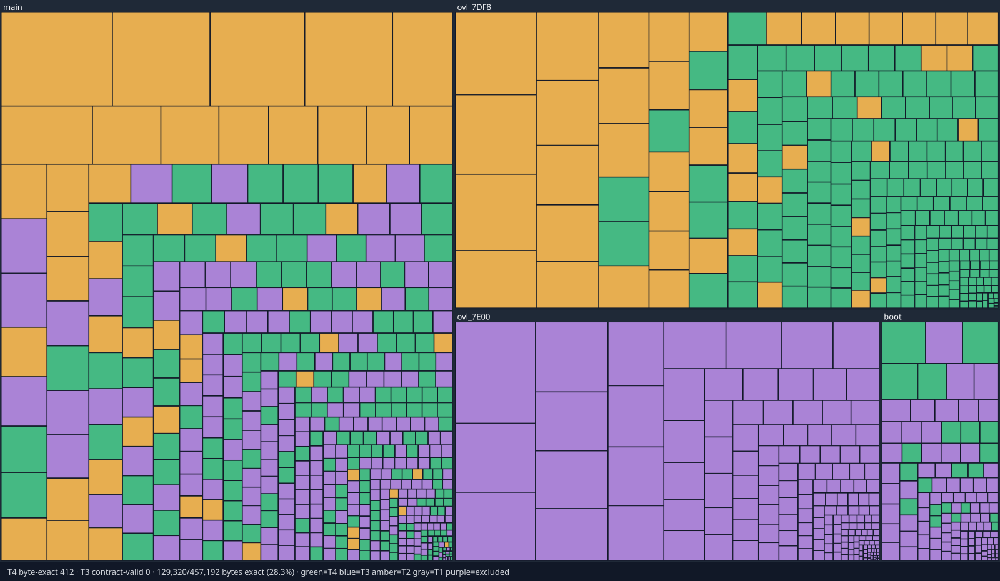

# Killer Instinct Gold (N64)

A byte-exact decompilation of *Killer Instinct Gold* (USA V1.0, `NKIE`) for
the Nintendo 64. Game C is compiled with IDO 5.3 (`-O2 -mips2`) and must
rebuild the retail ROM byte for byte. No ROM or asset data is in this
repository.

## Current Status

Both milestones count original CPU function bytes in `boot`, `main`,
`ovl_7DF8`, and `ovl_7E00`. M1 is behavior-validated (T3) plus byte-exact
(T4). M2 is byte-exact only. Explicitly excluded functions (libultra/SDK and
handwritten overlay asm) stay out of the denominator.

The blocks below are snapshots; regenerate the bars and the treemap with
`make progress`. Do not hand-edit them.

<!-- progress-begin -->
_Snapshot 2026-11-03._

```
M1  Contract-valid (T3 + T4)
    ████████████████░░░░░░░░░░░░░░░░░░░░░░░░  40.8%   118,224 / 289,876 B   398 / 509 fns
M2  Byte-exact (T4)
    ████████████████░░░░░░░░░░░░░░░░░░░░░░░░  40.8%   118,224 / 289,876 B   398 / 509 fns
```

| Area | M1: contract-valid | M2: byte-exact |
|---|---|---|
| **boot** | `████████████████████` 100.0%: 8,468 / 8,468 B, 21 / 21 fns | `████████████████████` 100.0%: 8,468 / 8,468 B, 21 / 21 fns |
| **main** | `███████░░░░░░░░░░░░░` 36.5%: 52,528 / 143,980 B, 180 / 237 fns | `███████░░░░░░░░░░░░░` 36.5%: 52,528 / 143,980 B, 180 / 237 fns |
| **ovl_7DF8** | `████████░░░░░░░░░░░░` 41.6%: 57,228 / 137,428 B, 197 / 251 fns | `████████░░░░░░░░░░░░` 41.6%: 57,228 / 137,428 B, 197 / 251 fns |
| **ovl_7E00** | `░░░░░░░░░░░░░░░░░░░░` n/a | `░░░░░░░░░░░░░░░░░░░░` n/a |
<!-- progress-end -->



Every box is one function, sized by its original bytes and grouped by image:
green = byte-exact (T4, M2), blue = contract-valid but not yet byte-exact (T3),
amber = still matching (T2), gray = not started (T1), purple = excluded
(SDK / handwritten asm). Green + blue is M1. Regenerate:
`python3 tools/progress/treemap.py --svg docs/progress-map.svg`.

## Building

You supply a big-endian dump of Killer Instinct Gold (USA) (V1.0). SHA1
`ba52e91b44450c548467044b26951353dc491e04`, 12,582,912 bytes.

```sh
ln -s "ROMs/Killer Instinct Gold (U) (V1.0) [!].z64" baserom.us.z64
./tools/setup.sh
make extract
make
make verify
```

`make` must emit a ROM identical to `baserom.us.z64`. Setup needs Linux
x86_64, Python 3, git, curl, tar, gcc, g++, and GNU make. Tooling lands under
`.venv/` and `tools/ext/` (gitignored). See [docs/toolchain.md](docs/toolchain.md).

## Progress

Tiers: T1 unstarted · T2 in the tree · T3 behavior-validated · T4 byte-exact ·
excluded (SDK / handwritten asm).

```sh
make progress                                      # inventory, README bars, HTML + SVG maps
python3 tools/progress/progress.py --readme --check  # fail if the README bars are stale
```

`docs/functions.csv` is the per-function ledger. `docs/t2_drafts.md` ranks every
still-matching (T2) function by its best committed draft and how many words differ
(`python3 tools/progress/t2_table.py`, run in the build toolbox after `make extract`). Manual overrides live in
`tools/progress/status.csv`. Never edit generated percentages by hand.
Methodology: [tools/progress/README.md](tools/progress/README.md). Task board:
[docs/TRACKING.md](docs/TRACKING.md).
